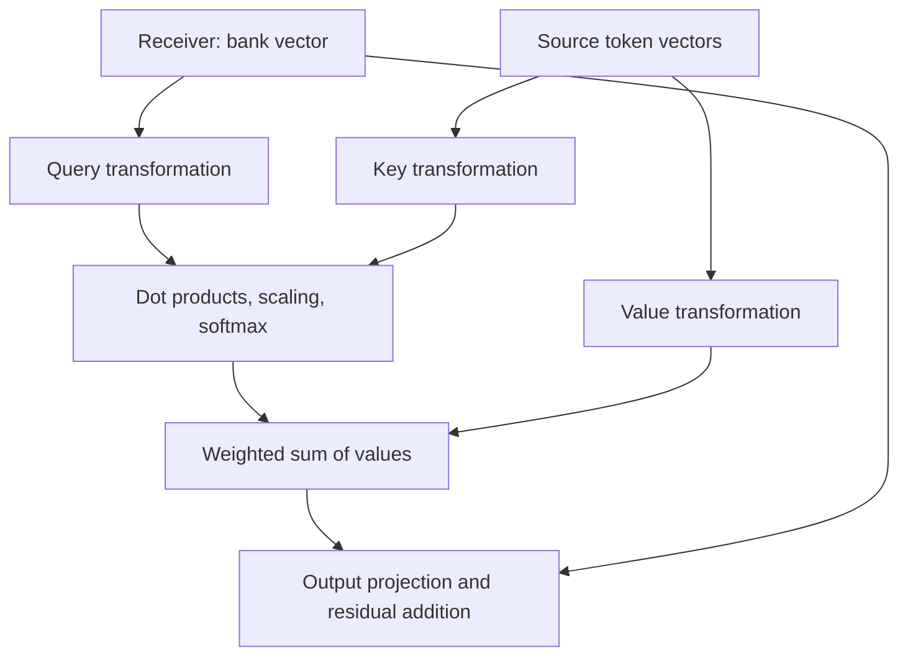

# Chapter 2 — Models

Book reference: [Chapter 2: Models](https://www.baseten.co/inference-engineering/book/02-models/).

All Chapter 2 explanations and examples live in this file. These are original study notes accompanying the book.

## Contents

- [Part I: from word vectors to attention to next-token prediction](#part-i--from-word-vectors-to-attention-to-next-token-prediction)
- [Part II: how the matrices are learned](#part-ii--how-the-matrices-are-learned)
- [Part III: runnable numerical companion](#part-iii--runnable-numerical-companion)
- [Learning log](#learning-log)

Read one worked step at a time. The toy calculations make the mechanics visible; their vectors are invented, not measurements from a trained model.

## Part I — From word vectors to attention to next-token prediction

Companion to [Chapter 2 of Inference Engineering](https://www.baseten.co/inference-engineering/book/02-models/). This is an original explanation built from our conversation.

### 1. What problem are we solving?

Consider:

> She deposited money at the bank

A fixed Word2Vec embedding gives “bank” the same vector in this sentence and in “She walked beside the river bank.” It cannot, by itself, distinguish which meaning this occurrence uses.

A transformer starts with token representations and updates them using the available context. We want the representation at “bank” to incorporate information from “money,” “deposited,” and other relevant tokens.

For these notes, pretend each displayed word is one token. Actual tokenizers can split words. Token IDs are lookup keys, not measures of meaning. An embedding lookup maps an ID to a vector. A vector with 4,096 numbers has 4,096 dimensions; a sequence of six such vectors has shape [6, 4096]. Hidden states are the intermediate representations calculated inside the network.

Moving from IDs to embeddings increases representation dimensionality. Successive transformer layers commonly keep the same main representation width while changing its values.

### 2. Why not just add every word equally?

Vector addition can mix information. But equal contributions give us no way to favor useful clues. We need a learned calculation of how much to take from each source for a particular receiver.

In our example, **bank is the receiver** and **money is a source**. Neither role permanently belongs to a word. Each position has its own attention calculation.

“Money should matter more than the” is an illustrative intuition, not a programmed rule. Real heads can use function words, position, syntax, or other features. Large attention weights are not by themselves a complete explanation of a model's reasoning.

### 3. Why transform vectors before comparing them?

Start with invented vectors:

| Token | Current vector |
|---|---|
| bank | [2, 3] |
| money | [1, 4] |
| the | [1, 3] |

A direct dot product compares bank and money:

$$[2,3]\cdot[1,4]=(2\times1)+(3\times4)=14.$$

The second coordinate contributes 12 of that score. Suppose we first transform bank by multiplying its second coordinate by 0.1:

$$[2,3]\longrightarrow[2,0.3].$$

Now the score is:

$$[2,0.3]\cdot[1,4]=2+1.2=3.2.$$

We changed which features influence the comparison. A matrix implements that adjustable transformation; training learns its entries. Real matrices can mix coordinates as well as rescale them. The dot-product operation itself stays unchanged.

The 0.1 transformation above only illustrates the motivation. The next section defines the transformations used throughout our main worked example.

### 4. Why two transformations: query and key?

What matters about the receiving token can differ from what matters about the source token. Let our toy transformations be:

| Role | Transformation | Name |
|---|---|---|
| Receiver side | Select the first coordinate | Query matrix |
| Source side | Select the second coordinate | Key matrix |

Using row vectors, the actual matrices are:

$$W_Q=\begin{bmatrix}1\\0\end{bmatrix},\qquad W_K=\begin{bmatrix}0\\1\end{bmatrix}.$$

Bank's query is calculated by applying the query matrix to bank:

$$q_{bank}=[2,3]W_Q=[2].$$

Money's key is calculated by applying the key matrix to money:

$$k_{money}=[1,4]W_K=[4].$$

Then compare those outputs:

$$\underbrace{2}_{\text{bank's query}}\times\underbrace{4}_{\text{money's key}}=\boxed{8}.$$

**The query matrix was applied to the receiver. The resulting query vector is then compared with the source's key vector. These are separate steps.**

If we reverse roles, money's query is [1] and bank's key is [3], giving 1 × 3 = 3. This shows that the score function can be directional. Reordering the same two vectors in a dot product would not change the answer; changing which token supplies the query uses different vectors.

In this particular causal sentence, money cannot actually attend forward to bank. The reverse calculation illustrates the scoring function only; a causal mask would disallow that connection.

### 5. How do matrices acquire these roles?

The architecture assigns the jobs; training learns useful parameters for those jobs.

- The matrix applied on the receiver side of the score calculation is called the query matrix.
- The matrix applied on the source side is called the key matrix.
- The matrix producing the information that gets mixed is called the value matrix.

Random matrices already occupy these computational roles before training. Their initial outputs are simply unhelpful. They do not need to discover that they are “questions” or “clues.” Those words are optional intuitions, not literal definitions of their entries.

Within a head and layer, the same query transformation is applied to every token. There is no bank-specific query matrix. During ordinary inference, the matrices remain fixed; their output vectors vary with the token representations. Later layers use already-contextual representations and have their own learned parameters.

### 6. Scores are not weights yet

Bank's query is [2]. Using the same key transformation:

| Source | Key | Raw score |
|---|---|---|
| money | [4] | 2 × 4 = 8 |
| the | [3] | 2 × 3 = 6 |

For hand arithmetic, **restrict this toy attention calculation to these two sources**. An ordinary causal attention head would also include the other allowed positions and bank itself. Adding those positions changes the softmax denominator and the resulting numbers.

Scores are divided by the square root of the query/key dimension. Here that dimension is one, so the divisor is sqrt(1) = 1. Larger heads use larger divisors to help control score scale.

Softmax converts scores into positive relative weights summing to one:

$$w_{money}=\frac{e^8}{e^8+e^6}\approx0.880797,$$

$$w_{the}=\frac{e^6}{e^8+e^6}\approx0.119203.$$

We will round these to **0.881 and 0.119** for hand calculations. A weight depends on the receiver and all the competing allowed scores; it is not a permanent importance attached to a word.

Dot products are not Euclidean distances. Their values depend on vector lengths and alignment. Cosine similarity normalizes away lengths; it is useful for comparing embeddings but is not this attention-weight calculation.

### 7. What do we actually retrieve? Values

Keys helped determine the amounts. We now need the vectors to mix. Let the value transformation double the first coordinate and retain the second:

$$W_V=\begin{bmatrix}2&0\\0&1\end{bmatrix}.$$

| Source | Current vector | Value vector |
|---|---|---|
| money | [1, 4] | [2, 4] |
| the | [1, 3] | [2, 3] |

Multiply each value by its attention weight:

$$0.881[2,4]=[1.762,3.524],$$

$$0.119[2,3]=[0.238,0.357].$$

Add the contributions:

$$z_{bank}=[1.762,3.524]+[0.238,0.357]=\boxed{[2,3.881]}.$$

This is the attention output for bank, not a new token.

#### Why add money and the?

We are combining their information into one vector for the receiver. This is a weighted average of value vectors, coordinate by coordinate. Both first coordinates are 2, so the result is 2. The second result, 3.881, lies between 3 and 4 and is closer to money's 4 because money has more weight.

Multiple sources can contribute. A separate value transformation lets the model learn what information to transmit independently of the features used to calculate matching scores.

### 8. Update bank's representation

A transformer combines attention-head outputs and applies an output projection. Use one toy head and an identity output projection here, so [2, 3.881] stays unchanged. Then the residual addition gives:

$$\underbrace{[2,3]}_{\text{bank's incoming representation}}+\underbrace{[2,3.881]}_{\text{attention contribution}}=\boxed{[4,6.881]}.$$

This is a temporary hidden-state update for this occurrence of bank. It does not rewrite the embedding table or retrain the model.

Real blocks also contain normalization and a feed-forward network with nonlinear operations and a residual connection. Their order depends on the architecture. We omit their numerical effects here to isolate how information moves between tokens.

### 9. How can the next layer use that context?

It receives the updated hidden states, not fresh embedding lookups. Temporarily ignoring the omitted operations, suppose the next layer's query matrix selects the second coordinate:

| Input to the next query transformation | Query output |
|---|---|
| Original bank [2, 3] | [3] |
| Contextual bank [4, 6.881] | [6.881] |

The new query indirectly depends on money and the because their contributions changed the input. Information gathered in one layer can therefore change attention in subsequent layers.

### 10. How does this predict a next token?

After the final layer and any final normalization, the last position's hidden state feeds a learned vocabulary projection, also called an output head or unembedding. It produces one score (logit) for every vocabulary token.

Treat [4, 6.881] as the final state for our toy example. Invent two output scoring vectors:

| Candidate next token | Learned output vector | Dot product with final state |
|---|---|---|
| . | [1, 0] | 4 × 1 + 6.881 × 0 = 4 |
| to | [0, 0.6] | 4 × 0 + 6.881 × 0.6 = 4.1286 |

“To” scores slightly higher. With the original [2, 3], the scores would have been 2 and 1.8, reversing that ranking. These arbitrary numbers show how context can change a prediction, not which continuation a trained model would actually prefer.

Vocabulary softmax converts all output logits to probabilities. This is a different softmax from attention softmax: attention normalizes across source positions; output softmax normalizes across vocabulary tokens. A decoding policy selects a token, which is appended to the sequence. The process repeats. Implementations usually cache prior keys and values instead of recomputing everything.

#### Why would a dot product decode anything useful?

It is a learned weighted sum of features. The arithmetic is simple; the learned weights supply the useful interpretation.

In a separate interpretive example, imagine h = [2, 5], where the first coordinate represents sentence-completion evidence and the second represents evidence that a purpose will follow. These semantic labels are invented; actual features are generally distributed.

| Candidate | Learned decoding weights | Weighted evidence score |
|---|---|---|
| . | [3, -1] | 3 × 2 - 1 × 5 = 1 |
| to | [-1, 2] | -1 × 2 + 2 × 5 = 8 |

For “to,” completion evidence reduces the score and purpose evidence increases it. Training jointly learns the hidden features and output weights. The dot product is therefore a **decoding operation**, not a magical similarity test that inherently knows the next word.

Decoding here predicts what can follow; it does not recover a next word already stored inside bank's vector. Earlier tokens remain available as context. The final hidden state is neither lossless nor guaranteed to capture every detail of the input.

### 11. One diagram of the core calculation



### 12. What next-token prediction does and does not imply

Predicting tokens is the objective and output mechanism, not a description of every internal computation learned to serve it. Learning representations of systems, relationships, and procedures can improve prediction. That does not prove that next-token training alone produces general intelligence or reliable reasoning. Capabilities must be tested rather than inferred from fluent text.

Continue with [Part II: how the matrices are learned](#part-ii--how-the-matrices-are-learned).

## Part II — How the matrices are learned

The worked attention example chose matrix entries to make their effects visible. This note explains where useful entries come from in training.

### 1. Who chooses the values?

For a model trained from scratch, parameters generally start with small random values chosen using an initialization scheme. During training, the model sees text and predicts the next token at eligible positions. The actual next tokens in the training text provide targets.

If the target token receives probability p, the usual token loss is -log(p). Assigning the actual token more probability reduces that loss. A training batch aggregates many such errors.

Backpropagation calculates how changing each parameter would locally change the loss. An optimizer uses those gradients to update the parameters. Embeddings, query/key/value matrices, feed-forward parameters, and output projections are trained together; there is no separate answer sheet of correct attention weights.

During ordinary inference, those learned parameters stay fixed. New prompts change the temporary hidden states and the query/key/value vectors calculated from them.

### 2. Why don't query and key become identical?

They are initialized separately and affect the loss through different uses in the computation. One shared objective does not imply identical parameter updates.

Use one scalar parameter for each matrix to see this without matrix notation:

| Quantity | Value |
|---|---:|
| Receiver input, bank | 2 |
| Source input, money | 3 |
| Query parameter a | 0.20 |
| Key parameter b | 0.50 |

The query is 2a, the key is 3b, and their score is:

$$s=(2a)(3b)=6ab.$$

The initial score is 6 × 0.20 × 0.50 = 0.60.

#### Change only the query parameter

Increase a from 0.20 to 0.21, leaving b = 0.50:

$$s_{new}=6\times0.21\times0.50=0.63.$$

The score increases by 0.03.

The shorthand 6 × 0.01 × 0.50 = 0.03 means:

- 6: the product of the two token inputs, 2 × 3.
- 0.01: the increase in a.
- 0.50: the unchanged b.
- 0.03: the change in score, not the score itself.

#### Reset, then change only the key parameter

Start again at a = 0.20 and b = 0.50. Increase b to 0.51:

$$s_{new}=6\times0.20\times0.51=0.612.$$

The score increases by 0.012.

| Experiment | Parameter increase | Score increase |
|---|---:|---:|
| Change a only | 0.01 | 0.030 |
| Change b only | 0.01 | 0.012 |

The score has different sensitivities to a and b. Backpropagation follows those sensitivities through softmax, the value mixture, and later layers all the way to prediction loss. It calculates derivatives rather than physically trying each perturbation. The optimizer need not update both entries by equal amounts.

This scalar example shows how different updates can arise; it is not a full training simulation. Real matrices also act on different token positions and participate in many coupled comparisons. Score increases are not universally good: the direction of a useful update comes from the loss.

### 3. What drives each matrix toward its role?

The architecture defines where each matrix is used:

| Matrix | Computational use | What training can improve |
|---|---|---|
| Query | Receiver side of matching | How receiver features affect source selection |
| Key | Source side of matching | How source features affect matching |
| Value | Information being mixed | What source information gets transmitted |
| Output head | Scores vocabulary tokens from final state | How contextual features predict continuations |

There is no explicit objective “make queries into questions.” All these parameters cooperate to reduce prediction loss, and their positions in the calculation determine the error signals they receive.

Different trained matrices can implement the same behavior; there is no unique required endpoint. For example, in our scalar score, doubling a and halving b preserves the product ab. The matrix case has analogous freedoms. Distinct labels do not require that every parameter be different.

If parameters were initialized identically and treated perfectly symmetrically by a computation, they could remain identical. Standard query/key roles and independently initialized parameters do not impose that constraint.

### 4. What is learned versus calculated?

| Learned parameters, ordinarily fixed at inference | Calculated for the current input |
|---|---|
| Embedding table | Starting token representations |
| Query/key/value matrices | Query/key/value vectors |
| Layer transformations | Contextual hidden states |
| Output head weights | Vocabulary logits and probabilities |

“The representation changed because of context” means the right-hand column changed. It does not mean the model retrained itself while answering.

## Part III — Runnable numerical companion

Copy the following block into a temporary file named `chapter_02_attention.py`, then run `python3 chapter_02_attention.py`. It requires no third-party dependencies. The example is embedded here to keep one file per chapter.

```python
"""Dependency-free numerical companion to Chapter 2.

One receiver, two explicitly selected sources, one attention head.
This is pedagogical arithmetic, not a complete transformer implementation.
"""

from math import exp, isclose, sqrt


def dot(a, b):
    if len(a) != len(b):
        raise ValueError("Dot product requires equal vector lengths")
    return sum(x * y for x, y in zip(a, b))


def matmul_row(vector, matrix):
    if len(vector) != len(matrix):
        raise ValueError("Vector width must equal matrix row count")
    return [dot(vector, column) for column in zip(*matrix)]


def softmax(scores):
    # Subtracting a shared maximum preserves softmax and avoids overflow.
    largest = max(scores)
    numerators = [exp(score - largest) for score in scores]
    total = sum(numerators)
    return [value / total for value in numerators]


def main():
    bank = [2.0, 3.0]
    sources = {"money": [1.0, 4.0], "the": [1.0, 3.0]}
    wq = [[1.0], [0.0]]       # Select receiver's first coordinate.
    wk = [[0.0], [1.0]]       # Select source's second coordinate.
    wv = [[2.0, 0.0], [0.0, 1.0]]  # Double first, retain second.

    query = matmul_row(bank, wq)
    keys = [matmul_row(vector, wk) for vector in sources.values()]
    values = [matmul_row(vector, wv) for vector in sources.values()]
    scores = [dot(query, key) / sqrt(len(query)) for key in keys]
    weights = softmax(scores)
    attention = [sum(w * v[j] for w, v in zip(weights, values)) for j in range(2)]
    # Identity output projection; normalization and FFN omitted.
    updated_bank = [x + y for x, y in zip(bank, attention)]

    print("Bank query:", query)
    for name, key, value, score, weight in zip(sources, keys, values, scores, weights):
        print(f"{name}: key={key}, value={value}, score={score:g}, weight={weight:.6f}")
    print("Attention output:", [round(x, 6) for x in attention])
    print("Bank after residual addition:", [round(x, 6) for x in updated_bank])

    # Treat the updated state as final only for this toy output-head example.
    output_vectors = {".": [1.0, 0.0], "to": [0.0, 0.6]}
    before = [dot(bank, vector) for vector in output_vectors.values()]
    after = [dot(updated_bank, vector) for vector in output_vectors.values()]
    probabilities = softmax(after)
    for token, old, new, probability in zip(output_vectors, before, after, probabilities):
        print(f"Next-token candidate {token!r}: old logit={old:.6f}, "
              f"new logit={new:.6f}, two-candidate probability={probability:.6f}")

    # Numerical checks of the lesson's key claims, using unrounded arithmetic.
    assert scores == [8.0, 6.0]
    assert isclose(sum(weights), 1.0)
    assert isclose(attention[0], 2.0)
    assert isclose(attention[1], 3.880797077977882)
    assert before[0] > before[1] and after[1] > after[0]
    assert isclose(6 * 0.21 * 0.5 - 0.6, 0.03)
    assert isclose(6 * 0.2 * 0.51 - 0.6, 0.012)
    print("All worked-example checks passed.")


if __name__ == "__main__":
    main()
```

## Learning log

| Date | Update |
|---|---|
| 2026-10-18 | Consolidated the October 14–16 discussion: Word2Vec, Q/K/V, learned matching, softmax, value mixing, residual updates, layers, next-token decoding, and training. |
| 2026-10-18 | Combined all Chapter 2 notes and the runnable example into this single chapter file. |

## Possible next topics

Multi-head attention; feed-forward networks and nonlinear activations; positional information; causal masking and the KV cache; prefill versus decode. These are not yet covered in depth by these notes.
